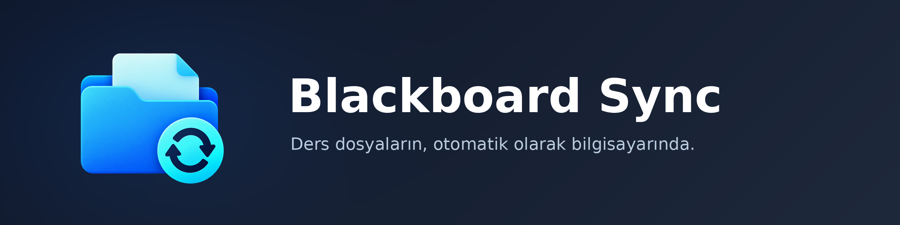

<p align="center"></p>

Downloads your Blackboard course content to your computer automatically.

## Features

- **Automatic downloads:** Checks Blackboard every hour in the background, downloads new files by itself and sends you a notification.
- **Tidy folders:** Files are saved in a **University** folder with Blackboard's own term and course structure.
- **Google Calendar (optional):** Send deadlines to a dedicated Blackboard Deadlines calendar; automatic updates after successful app syncs. [Client setup](docs/GOOGLE_CALENDAR_SETUP.md).
- **Calendar:** See the due dates of assignments, exams and other graded work day by day, with the course name.
- **Announcements:** Every synced announcement from your current-term courses in one place, newest first; open the saved notes from there.
- **Courses:** Untick a course you don't want and it is no longer synced. The folder is a copy of Blackboard; deleted or damaged files come back by themselves.
- **Past terms — coming soon:** The archive download flow is being redesigned; its desktop controls are temporarily disabled.
- **Pause:** Stop syncing whenever you like and resume with one click.
- **One-click updates:** When a new version is out you get a notification; just press **Update**.
- **English or Turkish:** Pick the app's language in Settings (English / Türkçe).
- **Light or dark (Windows):** Follow Windows or pick a theme in Settings → Appearance.
- **Easy uninstall:** Remove the app and its data with one button in Settings.

## Installation

[Download the latest version](https://github.com/UmutYLCN/blackboard-sync/releases/latest):

- **macOS:** Open the `.dmg` and drag the app into the **Applications** folder.
- **Windows:** Run `Setup.exe`. If SmartScreen warns you, choose **More info → Run anyway**.

Or with a single command in the terminal:

```sh
# macOS
curl -fsSL https://raw.githubusercontent.com/UmutYLCN/blackboard-sync/main/install.sh | sh
```

```powershell
# Windows (PowerShell)
irm https://raw.githubusercontent.com/UmutYLCN/blackboard-sync/main/install.ps1 | iex
```

On first launch choose your school's address and the folder to save files in, then **Sign in**. See the [user guide](docs/USAGE.md) for details and terminal commands.

## Privacy

You type your password only into your school's own sign-in page; the app never sees it and never stores it. The saved sign-in session stays on your computer and is sent only to your school’s Blackboard server.

Optional Google Calendar sends event titles, course names, due times and Blackboard links to Google in a dedicated **Blackboard Deadlines** calendar. Your main calendar and personal events are not accessed. Refresh tokens stay in the OS credential store (private JSON on other platforms); event mappings and connection status are private local files. Disconnect in Settings or the CLI to revoke access; optionally delete the dedicated calendar. Keeping the calendar retains only its ID locally for reconnection. Access can also be revoked at [Google Account connections](https://myaccount.google.com/connections). The app contacts Blackboard, GitHub for supported builds' updates, and Google only when Calendar is enabled. See the [privacy policy](site/privacy.html).

Blackboard Sync's use and transfer of information received from Google APIs adhere to the [Google API Services User Data Policy](https://developers.google.com/terms/api-services-user-data-policy), including the Limited Use requirements.

🌐 **Website:** [blackboardsyncapp.com](https://blackboardsyncapp.com/)


---

License: [MIT](LICENSE).

Blackboard Sync is an independent project; it is not affiliated with or endorsed by Anthology Inc.
