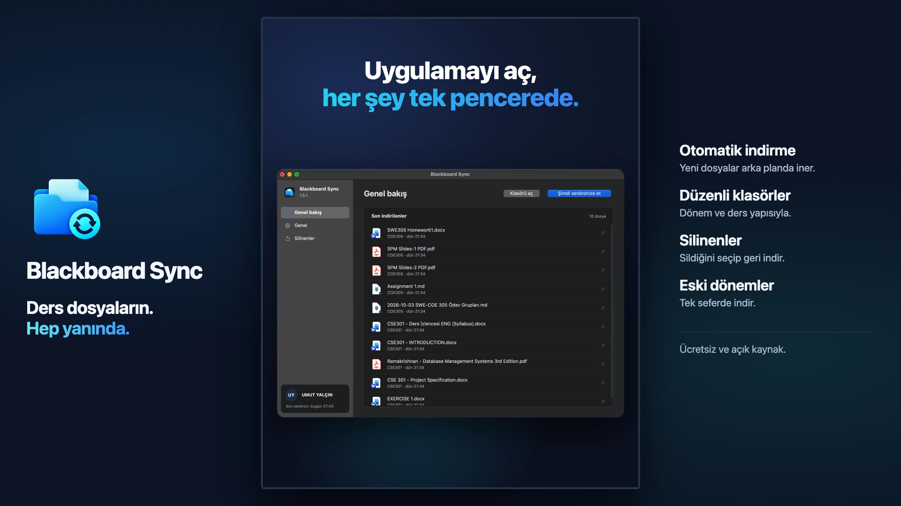

# Microsoft Store submission

Listing text, Windows screenshots, artwork and the Partner Center checklist.
The maintainer uploads media and submits in Partner Center.

The package identity is already in the repository (`packaging/msix/identity.toml`,
`docs/MSIX.md`): `UmutYLCN.blackboard-sync`, publisher display name `UmutYLCN`, reserved
Store name `blackboard-sync` ("Blackboard Sync" is taken by another app). The Start menu
still shows **Blackboard Sync**.

## Contents

| Path | What it is |
| --- | --- |
| `listing-{en,tr,es,fr,de,ar}.md` | Six Store listings with captions in upload order |
| `screenshots/` | Nine 1920×1080 images per language, with Turkish at the root and the others in language subfolders |
| `screenshots/capture.py` | Captures the Windows app’s WebView2 page and draws the notification-area menu |
| `screenshots/render.sh` | Renders the localized screenshots in upload order |
| `screenshots/src/` | Template, localized screenshot titles and captions, and raw captures under `windows/` |
| `trailer/make-trailer.sh` | Builds the 1920x1080 trailer and its thumbnail into `out/` |
| `trailer/draft-trailer-thumbnail.png` | The thumbnail it makes, for review |
| `images/hero-art.png` | 16:9 Super hero art, 1920x1080 (no text, no UI) |
| `images/poster-art.png` | Poster art, 1440x2160 (logo and app name) |
| `images/box-art.png` | 1:1 box art, 2160x2160 (logo and app name) |
| `images/store-logo-{300,150,71}.png` | 1:1 app tile icons, 300x300, 150x150 and 71x71 |
| `images/make-images.sh` | Renders the artwork and scales the tile icons |
| `shot.sh` | Headless Chrome screenshot helper used by the scripts |
| `out/` | Generated videos and downloads; ignored by git |

The scripts run on macOS with Google Chrome (`CHROME=/path/to/chrome` to use another
Chrome), Node.js for the screenshot manifest, and `ffmpeg` for the trailer.

## Before you start

1. Build the submission package with the manual Store workflow (see [4. Packages](#4-packages)).
2. Do the manual test in `docs/MSIX.md` ("Manual Windows verification still required")
   with that exact `.msix`, signed with the test certificate as described there.
3. Use the nine final Store images per language in [Screenshots](#screenshots). Capture additional
   screens during future manual tests to improve the listing.

## Partner Center checklist

Microsoft's reference: [Create an app submission for your MSIX app](https://learn.microsoft.com/en-us/windows/apps/publish/publish-your-app/msix/create-app-submission).
Items marked **Decide** are the maintainer's call; all are collected again under
[Open decisions](#open-decisions).

### 1. Pricing and availability

- [ ] **Markets:** **Decide.** All markets (the default) or Turkey only. The built-in directory contains verified Blackboard Learn addresses. Students can also enter a school address directly.
- [ ] **Audience:** Public audience.
- [ ] **Discoverability:** Make this product available and discoverable in the Microsoft Store.
- [ ] **Schedule:** Release as soon as possible; Stop acquisition never. (Use
  [6. Submission options](#6-submission-options) to hold the release instead.)
- [ ] **Base price:** One-time purchase, approximately US$5, with a one-day free trial in Partner Center.
- [ ] **Organizational licensing:** leave the defaults.

### 2. Properties

- [ ] **Category:** Education, subcategory **Study aids**. **Decide** on an optional
  secondary category: Productivity ("apps which help user to complete a particular task
  more efficiently") is the closest; Utilities + tools also fits.
- [ ] **Privacy:** "Does this product access, collect or transmit personal information?"
  **Yes.** The app stores the Blackboard session cookies, user ID, user name and display
  name on the PC and sends the cookies to the school's Blackboard server.
- [ ] **Privacy policy URL:** `https://blackboardsyncapp.com/privacy`.
  The page is in English and says which statements apply to the macOS, Windows Setup and
  Microsoft Store builds. Its "Microsoft Store build" section covers the package's data
  folder (`%LOCALAPPDATA%\Packages\<family name>\LocalCache\Roaming\blackboard-sync`),
  the startup task (instead of the `HKCU\…\Run` value), no GitHub contact or self-update,
  removal through Windows Settings > Apps, and separate data from the Setup build. The `/gizlilik` address redirects to the Turkish privacy page at `/tr/privacy`.
- [ ] **Website:** `https://blackboardsyncapp.com/`.
- [ ] **Support contact info:** **Decide.** `https://github.com/UmutYLCN/blackboard-sync/issues`
  (what the privacy page names) or an email address. Required only for Xbox.
- [ ] **Contact details:** required only for company accounts.
- [ ] **Display mode:** leave all unchecked.
- [ ] **Product declarations:**
  - "Allows users to make purchases, but does not use the Microsoft Store commerce system": unchecked (no purchases).
  - "Tested to meet accessibility guidelines": unchecked (not tested to that standard).
  - "Can install to alternate drives or removable storage": leave checked (default).
  - "Windows can include this product's data in automatic backups to OneDrive": default
    checked. **Decide:** the app data holds the Blackboard session; unchecking keeps it out
    of backups.
  - Pen and ink, generative AI: unchecked.
- [ ] **System requirements:** leave empty. The package already requires Windows 10
  version 1809 (10.0.17763) or later, x64.

### 3. Age ratings

The IARC questionnaire ([Microsoft's page](https://learn.microsoft.com/en-us/windows/apps/publish/publish-your-app/msix/age-ratings)).
The exact questions depend on the category picked first and can change; the answers
below follow what the app does. Check each question's info icon when its wording differs.

| Question | Answer | Why |
| --- | --- | --- |
| Category of the app | Not a game; the type for educational/reference or utility/productivity apps | It downloads course files |
| Violence, fear, blood | No | The app has no such content of its own |
| Sexual content or nudity | No | Same |
| Crude language, profanity, discrimination | No | Same |
| Drugs, alcohol, tobacco | No | Same |
| Gambling, simulated gambling | No | Same |
| Users can interact or exchange content with other users (chat, posting, sharing) | No | It only downloads from the student's own courses; nothing is posted |
| Shares the user's location | No | It reads no location |
| Shares personal information with third parties | Yes, optional | Optional integrations send data to Google at the user’s request. Disclose this sharing in the submission. Blackboard cookies go only to the school. |
| Digital purchases | No | No in-app purchases |
| Unrestricted internet access (for example a web browser) | No | The sign-in window opens the school's sign-in page; the app is not a browser. Confirm against the question's info text |

The course material comes from the student's school, not from the app. Expect the lowest
rating in most regions; IARC decides.

### 4. Packages

The Store signs the package, so upload the **unsigned** `.msix` from the
**Microsoft Store package** workflow. Ordinary CI artifacts omit production Google
OAuth metadata and are for testing only.

1. Run the workflow on the tested `main` commit. It checks production OAuth configuration inside the installed package and exercises startup, tray activation and package behavior.
2. Download the artifact after the workflow succeeds:

   ```sh
   gh workflow run store.yml --ref main
   gh run list --workflow store.yml --status success --limit 5
   gh run download <run-id> --name microsoft-store --dir store/microsoft/out/msix
   ```

   Or: GitHub > Actions > Microsoft Store package > the successful run > Artifacts >
   `microsoft-store`. It includes the unsigned MSIX, checksum and source commit.
3. Partner Center > Packages: upload the release workflow’s unsigned
   `Blackboard-Sync-<version>-x64.msix`. The Store signs the production package.
3. **Device family availability:** Windows 10/11 Desktop only (the manifest's
   `Windows.Desktop`); leave the others off.
5. Partner Center reports the package's languages (`en-US`, the default, and `tr-TR`), the restricted capability
   `runFullTrust` and the identity; they must match `packaging/msix/identity.toml`.

### 5. Store listings

- [ ] **Languages:** English (`en-us`), Turkish (`tr-tr`), Spanish (`es`), French (`fr`),
  German (`de`) and Arabic (`ar`).
- [ ] **Text:** use the corresponding `listing-<lang>.md`. The description limit is
  10,000 characters and the short description limit is 1,000. Leave release notes blank
  for the first publication. Enter up to 20
  product features (200 characters each) and seven keywords (40 characters each).
  Keep the reserved Store title `blackboard-sync` for every language.
- [ ] **Screenshots:** upload the nine PNGs in filename order, with the captions in the
  matching listing.
- [ ] **Bulk import:** choose **Import listings → Import folder → Select folder** and select the folder
  containing the UTF-8 Partner Center export CSV and its images. Keep the folder name
  because the CSV paths start with it.
  Review all six languages after import.
  [MSIX listing import and export](https://learn.microsoft.com/en-us/windows/apps/publish/publish-your-app/msix/import-and-export-store-listings)
- [ ] **Store logos:** poster art (1440x2160): `images/poster-art.png`; 1:1 box art
  (2160x2160): `images/box-art.png`; 1:1 app tile icons: `images/store-logo-300.png`
  (300x300), `images/store-logo-150.png` (150x150), `images/store-logo-71.png` (71x71).
- [ ] **Trailer:** skip it for the first submission (decided; see [Trailer](#trailer)). The
  promo video shows the macOS app; a trailer built from Windows captures can be added in a
  later submission (`out/trailer-1920x1080.mp4`, thumbnail `out/trailer-thumbnail.png`, title
  from the listing file).
- [ ] **16:9 Super hero art:** `images/hero-art.png`. Optional, but Microsoft shows trailers
  at the top of the listing only when this image is there.
- [ ] **Supplemental fields:** short title, sort title, voice title and additional system
  requirements: leave empty.
- [ ] **Additional license terms:** leave empty (all rights reserved; see the listing files).

### 6. Submission options

- [ ] **Publishing hold:** **Decide.** The default publishes as soon as certification
  passes. "Don't publish this submission until I select Publish now" lets you check the
  live listing text first.
- [ ] **Restricted capabilities (`runFullTrust`):** required. Suggested text:

  ```text
  Blackboard Sync is a desktop app packaged with the Desktop Bridge (Windows.FullTrustApplication; a PyInstaller-built Win32 executable). runFullTrust is required for it to run as a full-trust desktop process: it shows a notification-area (tray) icon and keeps syncing after its window is closed, downloads course files into a folder the user chooses (default Documents\University), starts the user's installed Chromium-based browser (Edge, Chrome and others) with a separate profile for sign-in, or shows a WebView2 sign-in window, and sends toast notifications. It declares no other restricted capabilities.
  ```

- [ ] **Notes for certification:** **Decide** how testers sign in. The app needs a school
  Blackboard Learn account, and Microsoft asks for test account credentials when an app
  requires sign-in ("If we can't fully test your submission, it may fail certification").
  Options: a test account from a school (if one can be arranged), or no account with an
  explanation and a link to the demo video. Suggested text for the second case (date it):

  ```text
  [date] This app downloads course files from a university's Blackboard Learn system. Signing in requires the student's own school account on the school's sign-in page, so we cannot provide a shared test account. Without an account testers can: open the app from Start (the "Get started" first-run page appears; the UI language can be changed under Settings > Language), enter any Blackboard address and choose a folder, open Settings (the gear; automatic sync interval, language, start at sign-in, the note that updates come from the Microsoft Store), and close the window to see the app keep running in the notification area. The Windows screenshots and optional Windows trailer in this submission illustrate the main screens. Full sync still requires a valid school account. The app has no analytics. It contacts the Blackboard address the user enters and its redirects. Optional Gemini Notebook export contacts Google.
  ```

- [ ] **Submission notification audience:** the account owner is notified by default; add
  others only if wanted.
- [ ] **Submit for certification** from the app overview page.

## Screenshots

Microsoft: desktop screenshots are PNG, 1366x768 or larger (up to 3840x2160), at most 50 MB,
up to 10 per language, with an optional caption of 200 characters each
([Screenshots, images and trailers](https://learn.microsoft.com/en-us/windows/apps/publish/publish-your-app/msix/screenshots-and-images)).
The Turkish set is at `screenshots/`, with English, Spanish, French, German and Arabic
in `en/`, `es/`, `fr/`, `de/` and `ar/`. The Arabic page, tray and screenshot titles
read right to left.

| Upload order | Content |
| --- | --- |
| `01-home.png` | Recent downloads, Gemini Notebook and the AI study session card |
| `02-gemini-notebook.png` | Connected Gemini Notebook card with course export controls |
| `03-ai-study.png` | AI study session card with the four available tool logos |
| `04-school-search.png` | Get started with matching schools as the student types |
| `05-calendar.png` | Upcoming deadlines with colour-coded course badges |
| `06-announcements.png` | Course announcements |
| `07-courses.png` | Course selection for sync |
| `08-languages.png` | Language selector expanded in Settings |
| `09-tray.png` | Windows notification-area menu |

### Sources and rendering

`capture.py` uses the Windows WebView2 page, synthetic data from `scripts/webui-preview.py`
and a drawn Windows 11 frame and tray. It displays the six language options from the app
as an expanded list for capture. `render.sh` pairs those captures with the localized titles
in `screenshots/src/shots.js`.

From the repository root, with Playwright Chromium and Node.js installed:

```sh
for lang in en tr es fr de ar; do
  PYTHONPATH=src python store/microsoft/screenshots/capture.py --lang "$lang"
  ./store/microsoft/screenshots/render.sh --lang "$lang"
done
```

Use `--only ID` to recapture a specific image. On Linux, `--font PATH` can supply
WOFF2 font files in place of Segoe UI. Set `CHROME` to override the Chromium executable.

## Trailer

Microsoft's requirements against what the script produces:

| Requirement | Trailer here |
| --- | --- |
| MP4 or MOV, at most 2 GB, 60 s or less recommended | MP4, about 34 MB, 56.65 s |
| Video 1920x1080 | 1920x1080, 30 fps (the source's rate) |
| H.264 High profile, progressive, 2 B-frames, closed GOP of half the frame rate, 4:2:0 | H.264 High, `-bf 2`, `-g 15 -flags +cgop`, yuv420p, capped at 50 Mbps |
| AAC-LC stereo, 48 kHz, 384 kbps | AAC-LC stereo 48 kHz, encoded with `-b:a 384k` (the source is mono 44.1 kHz, so both channels carry it and the encoder uses less) |
| moov atom at the front | `-movflags +faststart` |
| Thumbnail PNG 1920x1080 | `out/trailer-thumbnail.png`, a still at 21 s |
| Title, 255 characters at most | In the listing files |
| No age rating in the trailer | None |

The promo video is 1080x1350 (portrait), which Microsoft does not accept. The script places
it at 800x1000 in a frame on a 1920x1080 page in the site's style (`trailer/src/background.html`:
logo, name and tagline on the left, four features on the right). It cuts the video at
54.15 s, where the LinkedIn line "Link yorumlarda 👇" appears, and holds the last clean
frame for 2.5 s with a fade-out.

```sh
./store/microsoft/trailer/make-trailer.sh          # downloads the promo video into out/
./store/microsoft/trailer/make-trailer.sh promo.mp4 # or uses a local copy
```

**Decided:** the first submission goes without a trailer. The promo video shows the macOS
app (macOS window frames, Finder) and an end card reading "macOS & Windows", and Microsoft
requires listing media to represent the product accurately, so a trailer of the macOS app
risks failing certification. A trailer can be added later, rebuilt from Windows captures
(the promo's `scene.html` with Windows images, then this script).



## Other images

```sh
./store/microsoft/images/make-images.sh
```

- `images/hero-art.png` (1920x1080): the logo on the site's background, centred in the top
  two-thirds, no text and no app UI, as Microsoft asks for Super hero art.
- `images/poster-art.png` (1440x2160) and `images/box-art.png` (2160x2160): the logo
  and `blackboard-sync` name on the hero art's background style, no app UI.
- `images/store-logo-300.png` (300x300), `images/store-logo-150.png` (150x150) and
  `images/store-logo-71.png` (71x71): `assets/icon/logo.png` scaled.

## Open decisions

1. **Notes for certification / test account:** how certification testers can sign in
   (school test account or explanation only). The biggest certification risk.
2. **Markets:** all markets or Turkey only.
3. **Category:** Education > Study aids is proposed; secondary category Productivity or none.
4. **Support contact:** GitHub Issues URL or an email address.
5. **OneDrive backup declaration:** keep the default (checked) or uncheck.
6. **Publishing hold:** publish on certification or hold until "Publish now".

## Settled decisions

- **Privacy policy page:** the page is now English, lives at `/privacy` (the old `/gizlilik`
  redirects there) and covers the Store package (data folder, startup task, no GitHub
  contact, removal through Windows Settings).
- **Trailer:** the first submission goes without one; a Windows-based trailer can come later.
- **Name spelling:** the copyright line and "Developed by" use "Umut Yalçın".
