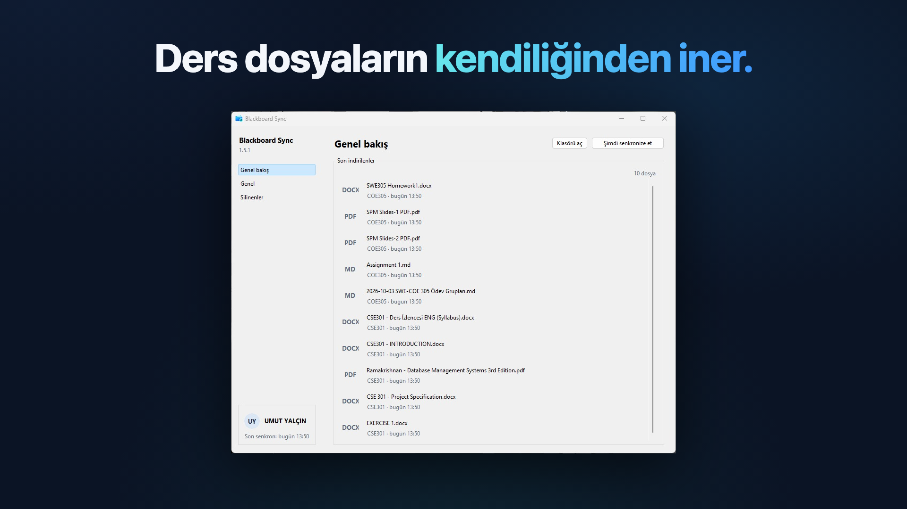

# Microsoft Store submission

Everything for the first Microsoft Store submission of the Windows app: a checklist that
follows Partner Center's submission sections, the listing text, Store images and the
trailer. The maintainer tests the package on a real Windows PC and submits it in Partner
Center; nothing here submits anything.

**Deadline:** send the submission before early January 2027, or the reservation of the
name `blackboard-sync` lapses.

The package identity is already in the repository (`packaging/msix/identity.toml`,
`docs/MSIX.md`): `UmutYLCN.blackboard-sync`, publisher display name `UmutYLCN`, reserved
Store name `blackboard-sync` ("Blackboard Sync" is taken by another app). The Start menu
still shows **Blackboard Sync**.

## Contents

| Path | What it is |
| --- | --- |
| `listing-tr.md` | Turkish Store listing (primary market), ready to paste |
| `listing-en.md` | English Store listing (additional language), ready to paste |
| `screenshots/01-genel-bakis.png`, `02-baslangic.png`, `03-ilk-senkron.png` | Final Windows screenshots, 1920x1080, in upload order (see [Screenshots](#screenshots)) |
| `screenshots/render.sh` | Renders the screenshots from `screenshots/src/` |
| `screenshots/src/` | `template.html`, `shots.js` (titles, captions, what to capture), `windows/` (the three Windows captures as PNG) |
| `trailer/make-trailer.sh` | Builds the 1920x1080 trailer and its thumbnail into `out/` |
| `trailer/draft-trailer-thumbnail.png` | The thumbnail it makes, for review |
| `images/hero-art.png` | 16:9 Super hero art, 1920x1080 (no text, no UI) |
| `images/poster-art.png` | Poster art, 1440x2160 (logo and app name) |
| `images/box-art.png` | 1:1 box art, 2160x2160 (logo and app name) |
| `images/store-logo-{300,150,71}.png` | 1:1 app tile icons, 300x300, 150x150 and 71x71 |
| `images/make-images.sh` | Renders the artwork and scales the tile icons |
| `shot.sh` | Headless Chrome screenshot helper used by the scripts |
| `out/` | Generated videos and downloads; ignored by git |

The scripts run on macOS with Google Chrome (`CHROME=/path/to/chrome` to use another
Chrome) and, for the trailer, `ffmpeg`.

## Before you start

1. Download the package from CI (see [4. Packages](#4-packages)).
2. Do the manual test in `docs/MSIX.md` ("Manual Windows verification still required")
   with that exact `.msix`, signed with the test certificate as described there.
3. Use the three final Windows images in [Screenshots](#screenshots). Capture additional
   screens during future manual tests to improve the listing.

## Partner Center checklist

Microsoft's reference: [Create an app submission for your MSIX app](https://learn.microsoft.com/en-us/windows/apps/publish/publish-your-app/msix/create-app-submission).
Items marked **Decide** are the maintainer's call; all are collected again under
[Open decisions](#open-decisions).

### 1. Pricing and availability

- [ ] **Markets:** **Decide.** All markets (the default) or Turkey only. The app works with
  any school's Blackboard Learn, but its interface is Turkish only.
- [ ] **Audience:** Public audience.
- [ ] **Discoverability:** Make this product available and discoverable in the Microsoft Store.
- [ ] **Schedule:** Release as soon as possible; Stop acquisition never. (Use
  [6. Submission options](#6-submission-options) to hold the release instead.)
- [ ] **Base price:** Free. No free trial, no sale pricing.
- [ ] **Organizational licensing:** leave the defaults.

### 2. Properties

- [ ] **Category:** Education, subcategory **Study aids**. **Decide** on an optional
  secondary category: Productivity ("apps which help user to complete a particular task
  more efficiently") is the closest; Utilities + tools also fits.
- [ ] **Privacy:** "Does this product access, collect or transmit personal information?"
  **Yes.** The app stores the Blackboard session cookies, user ID, user name and display
  name on the PC and sends the cookies to the school's Blackboard server.
- [ ] **Privacy policy URL:** `https://blackboard-sync.umutyalcin.workers.dev/privacy`.
  The page is in English and says which statements apply to the macOS, Windows Setup and
  Microsoft Store builds. Its "Microsoft Store build" section covers the package's data
  folder (`%LOCALAPPDATA%\Packages\<family name>\LocalCache\Roaming\blackboard-sync`),
  the startup task (instead of the `HKCU\…\Run` value), no GitHub contact or self-update,
  removal through Windows Settings > Apps, and separate data from the Setup build. The old
  `/gizlilik` address redirects to it.
- [ ] **Website:** `https://blackboard-sync.umutyalcin.workers.dev`.
- [ ] **Support contact info:** **Decide.** `https://github.com/UmutYLCN/blackboard-sync/issues`
  (what the privacy page names) or an email address. Required only for Xbox.
- [ ] **Contact details:** required only for company accounts.
- [ ] **Display mode:** leave all unchecked.
- [ ] **Product declarations:**
  - "Allows users to make purchases, but does not use the Microsoft Store commerce system": unchecked (no purchases).
  - "Tested to meet accessibility guidelines": unchecked (not tested to that standard).
  - "Can install to alternate drives or removable storage": leave checked (default).
  - "Windows can include this product's data in automatic backups to OneDrive": default
    checked. **Decide:** the app data holds the Blackboard session; unchecking keeps it out
    of backups.
  - Pen and ink, generative AI: unchecked.
- [ ] **System requirements:** leave empty. The package already requires Windows 10
  version 1809 (10.0.17763) or later, x64.

### 3. Age ratings

The IARC questionnaire ([Microsoft's page](https://learn.microsoft.com/en-us/windows/apps/publish/publish-your-app/msix/age-ratings)).
The exact questions depend on the category picked first and can change; the answers
below follow what the app does. Check each question's info icon when its wording differs.

| Question | Answer | Why |
| --- | --- | --- |
| Category of the app | Not a game; the type for educational/reference or utility/productivity apps | It downloads course files |
| Violence, fear, blood | No | The app has no such content of its own |
| Sexual content or nudity | No | Same |
| Crude language, profanity, discrimination | No | Same |
| Drugs, alcohol, tobacco | No | Same |
| Gambling, simulated gambling | No | Same |
| Users can interact or exchange content with other users (chat, posting, sharing) | No | It only downloads from the student's own courses; nothing is posted |
| Shares the user's location | No | It reads no location |
| Shares personal information with third parties | No | The session goes only to the school's own Blackboard (privacy page: "Your data is not shared with, sold or rented to any third party") |
| Digital purchases | No | Free, no in-app purchases |
| Unrestricted internet access (for example a web browser) | No | The sign-in window opens the school's sign-in page; the app is not a browser. Confirm against the question's info text |

The course material comes from the student's school, not from the app. Expect the lowest
rating in most regions; IARC decides.

### 4. Packages

The Store signs the package, so upload the **unsigned** `.msix` from CI, not the test-signed
copy.

1. Pick the `main` commit you tested. The `msix` job of the **CI** workflow builds it on
   every push to `main` and keeps it as the workflow artifact `msix`
   (`Blackboard-Sync-<version>-x64.msix`). Artifacts expire (GitHub's default is 90 days),
   so download it soon after the push.
2. Download it:

   ```sh
   gh run list --workflow ci.yml --branch main --status success --limit 5
   gh run download <run-id> --name msix --dir store/microsoft/out/msix
   ```

   Or: GitHub > Actions > CI > the run for that commit > Artifacts > `msix`.
3. Partner Center > Packages: upload `Blackboard-Sync-<version>-x64.msix`. The version is
   the app version with a fourth part of 0 (`1.5.1` → `1.5.1.0`). Each later submission
   needs a higher version.
4. **Device family availability:** Windows 10/11 Desktop only (the manifest's
   `Windows.Desktop`); leave the others off.
5. Partner Center reports the package's language (`tr-TR`), the restricted capability
   `runFullTrust` and the identity; they must match `packaging/msix/identity.toml`.

### 5. Store listings

- [ ] **Languages:** Turkish comes from the package. **Decide** whether to add English
  (**Add/remove languages > Manage additional languages**).
- [ ] **Text:** paste from `listing-tr.md` (and `listing-en.md`): description, short
  description, product features, keywords, copyright and trademark info, developed by.
  Leave "What's new in this version" empty for the first submission. The non-affiliation
  sentence is the second paragraph of the description and part of the copyright line.
- [ ] **Screenshots:** upload `01-genel-bakis.png`, `02-baslangic.png`, then
  `03-ilk-senkron.png`, with the captions from the listing file. These are the final
  Windows images. Upload the same Turkish-titled images separately for each language.
- [ ] **Store logos:** poster art (1440x2160): `images/poster-art.png`; 1:1 box art
  (2160x2160): `images/box-art.png`; 1:1 app tile icons: `images/store-logo-300.png`
  (300x300), `images/store-logo-150.png` (150x150), `images/store-logo-71.png` (71x71).
- [ ] **Trailer:** skip it for the first submission (decided; see [Trailer](#trailer)). The
  promo video shows the macOS app; a trailer built from Windows captures can be added in a
  later submission (`out/trailer-1920x1080.mp4`, thumbnail `out/trailer-thumbnail.png`, title
  from the listing file).
- [ ] **16:9 Super hero art:** `images/hero-art.png`. Optional, but Microsoft shows trailers
  at the top of the listing only when this image is there.
- [ ] **Supplemental fields:** short title, sort title, voice title and additional system
  requirements: leave empty.
- [ ] **Additional license terms:** leave empty (MIT; see the listing files).

### 6. Submission options

- [ ] **Publishing hold:** **Decide.** The default publishes as soon as certification
  passes. "Don't publish this submission until I select Publish now" lets you check the
  live listing text first.
- [ ] **Restricted capabilities (`runFullTrust`):** required. Suggested text:

  ```text
  Blackboard Sync is a desktop app packaged with the Desktop Bridge (Windows.FullTrustApplication; a PyInstaller-built Win32 executable). runFullTrust is required for it to run as a full-trust desktop process: it shows a notification-area (tray) icon and keeps syncing after its window is closed, downloads course files into a folder the user chooses (default Documents\University), starts the user's installed Chromium-based browser (Edge, Chrome and others) with a separate profile for sign-in, or shows a WebView2 sign-in window, and sends toast notifications. It declares no other restricted capabilities.
  ```

- [ ] **Notes for certification:** **Decide** how testers sign in. The app needs a school
  Blackboard Learn account, and Microsoft asks for test account credentials when an app
  requires sign-in ("If we can't fully test your submission, it may fail certification").
  Options: a test account from a school (if one can be arranged), or no account with an
  explanation and a link to the demo video. Suggested text for the second case (date it):

  ```text
  [date] This app downloads course files from a university's Blackboard Learn system. Signing in requires the student's own school account on the school's sign-in page, so we cannot provide a shared test account. Without an account testers can: open the app from Start (the "Başlangıç" first-run page appears; the UI is Turkish), enter any Blackboard address and choose a folder, open the "Genel" settings (automatic sync interval, start at sign-in, the note that updates come from the Microsoft Store), and close the window to see the app keep running in the notification area. A demo of a full sync: https://github.com/user-attachments/assets/d7e1e0a7-a25b-4412-824b-52ee71d25b03 . The app has no analytics and contacts only the Blackboard address the user enters.
  ```

- [ ] **Submission notification audience:** the account owner is notified by default; add
  others only if wanted.
- [ ] **Submit for certification** from the app overview page.

## Screenshots

Microsoft: desktop screenshots are PNG, 1366x768 or larger (up to 3840x2160), at most 50 MB,
up to 10 per language, with an optional caption of 200 characters each
([Screenshots, images and trailers](https://learn.microsoft.com/en-us/windows/apps/publish/publish-your-app/msix/screenshots-and-images)).
They must show the Windows app as it is. The images here are 1920x1080 with one large
Turkish title at the top (Microsoft asks for key visuals and text in the top two-thirds).

The first submission uses the three **light-mode Windows** captures taken by the
maintainer. These final PNGs have no TASLAK label; the old macOS drafts and their inputs
have been removed. Use the same Turkish-titled images for both listing languages.

| Final image / input filename | Windows capture | Original size |
| --- | --- | --- |
| [01-genel-bakis.png](screenshots/01-genel-bakis.png) | **Genel bakış**, after a sync: **Son indirilenler**, 10 files | 942x726 |
| [02-baslangic.png](screenshots/02-baslangic.png) | **Başlangıç**: school Blackboard address, save folder, **Bilgisayar açılınca başlat**, **Giriş yap** | 942x672 |
| [03-ilk-senkron.png](screenshots/03-ilk-senkron.png) | **Genel bakış**, first sync: **Yeni içerik kontrol ediliyor…**, **Senkron sürüyor** | 942x672 |



### Sources and rendering

Inputs are in `screenshots/src/windows/`. They were converted to PNG from
`genel-bakis-liste.jpeg`, `baslangic.jpeg` and `senkron-suruyor.jpeg`, respectively,
received via WhatsApp. The conversion preserves the decoded pixels and original
sizes; it cannot recover detail lost to JPEG compression. No sharpening or artificial
upscaling was applied. The existing template fits each capture within its image area.

Render from the repository root:

```sh
./store/microsoft/screenshots/render.sh
```

The three final 1920x1080 PNGs are written directly to `screenshots/`. Upload them in the
table's order, with the captions in `listing-tr.md` or `listing-en.md` (also stored in
`screenshots/src/shots.js`). The maintainer's upload copies are in
`~/Downloads/blackboard-sync-store/screenshots-final/`.

### To add later

These three captures are enough for the first submission. The following have no Windows
captures yet and are deliberately absent from `shots.js` and the final image set:

- **Silinenler**: a few deleted files available to download again.
- **Eski dönemler**: a past term selected in the settings.
- **Klasörler**: File Explorer showing the University term/course folder structure.
- **Genel settings**: automatic sync options and other settings.

**Dark-mode captures** could not be taken and are also a later improvement. Higher-quality
PNG originals, transferred without WhatsApp compression, can replace the current inputs
later. Capture only the Windows app window, keep private information out of view, and add
new entries to `shots.js` only when the corresponding Windows captures are available.

## Trailer

Microsoft's requirements against what the script produces:

| Requirement | Trailer here |
| --- | --- |
| MP4 or MOV, at most 2 GB, 60 s or less recommended | MP4, about 34 MB, 56.65 s |
| Video 1920x1080 | 1920x1080, 30 fps (the source's rate) |
| H.264 High profile, progressive, 2 B-frames, closed GOP of half the frame rate, 4:2:0 | H.264 High, `-bf 2`, `-g 15 -flags +cgop`, yuv420p, capped at 50 Mbps |
| AAC-LC stereo, 48 kHz, 384 kbps | AAC-LC stereo 48 kHz, encoded with `-b:a 384k` (the source is mono 44.1 kHz, so both channels carry it and the encoder uses less) |
| moov atom at the front | `-movflags +faststart` |
| Thumbnail PNG 1920x1080 | `out/trailer-thumbnail.png`, a still at 21 s |
| Title, 255 characters at most | In the listing files |
| No age rating in the trailer | None |

The promo video is 1080x1350 (portrait), which Microsoft does not accept. The script places
it at 800x1000 in a frame on a 1920x1080 page in the site's style (`trailer/src/background.html`:
logo, name and tagline on the left, four features on the right). It cuts the video at
54.15 s, where the LinkedIn line "Link yorumlarda 👇" appears, and holds the last clean
frame for 2.5 s with a fade-out.

```sh
./store/microsoft/trailer/make-trailer.sh          # downloads the promo video into out/
./store/microsoft/trailer/make-trailer.sh promo.mp4 # or uses a local copy
```

**Decided:** the first submission goes without a trailer. The promo video shows the macOS
app (macOS window frames, Finder) and an end card reading "macOS & Windows", and Microsoft
requires listing media to represent the product accurately, so a trailer of the macOS app
risks failing certification. A trailer can be added later, rebuilt from Windows captures
(the promo's `scene.html` with Windows images, then this script).


## Other images

```sh
./store/microsoft/images/make-images.sh
```

- `images/hero-art.png` (1920x1080): the logo on the site's background, centred in the top
  two-thirds, no text and no app UI, as Microsoft asks for Super hero art.
- `images/poster-art.png` (1440x2160) and `images/box-art.png` (2160x2160): the logo
  and `blackboard-sync` name on the hero art's background style, no app UI.
- `images/store-logo-300.png` (300x300), `images/store-logo-150.png` (150x150) and
  `images/store-logo-71.png` (71x71): `assets/icon/logo.png` scaled.

## Open decisions

1. **Notes for certification / test account:** how certification testers can sign in
   (school test account or explanation only). The biggest certification risk.
2. **Markets:** all markets or Turkey only.
3. **English listing:** add it or not (the screenshots keep their Turkish titles).
4. **Category:** Education > Study aids is proposed; secondary category Productivity or none.
5. **Support contact:** GitHub Issues URL or an email address.
6. **OneDrive backup declaration:** keep the default (checked) or uncheck.
7. **Publishing hold:** publish on certification or hold until "Publish now".

## Settled decisions

- **Screenshots:** use the three available light-mode Windows captures with Turkish titles
  for the first submission, including the English listing if added. More views and dark
  mode can follow later.

- **Privacy policy page:** the page is now English, lives at `/privacy` (the old `/gizlilik`
  redirects there) and covers the Store package (data folder, startup task, no GitHub
  contact, removal through Windows Settings).
- **Trailer:** the first submission goes without one; a Windows-based trailer can come later.
- **Name spelling:** the copyright line and "Developed by" use "Umut Yalçın".
